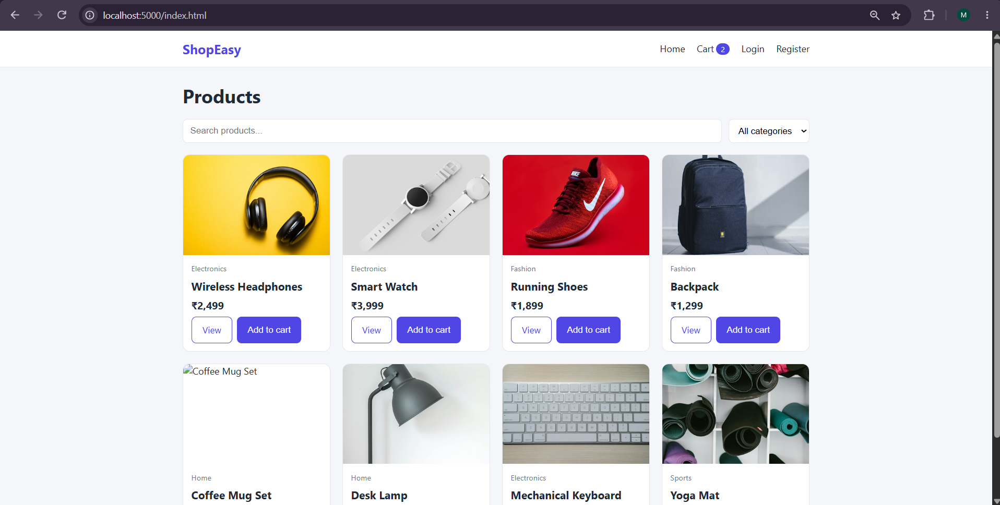
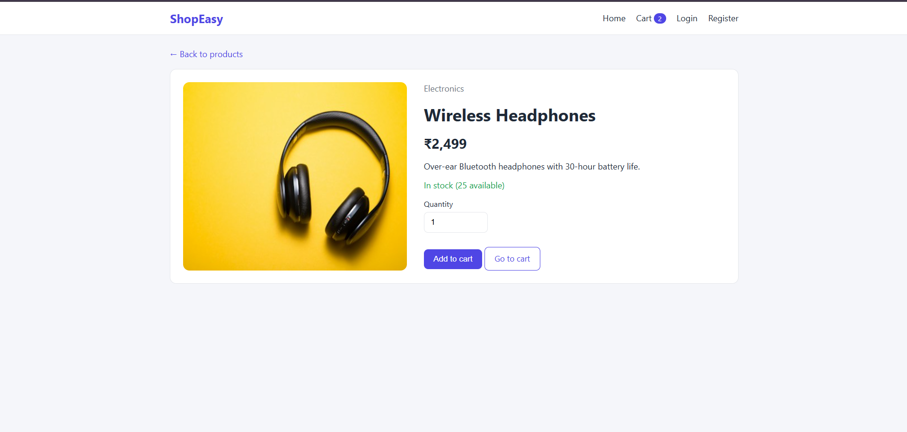
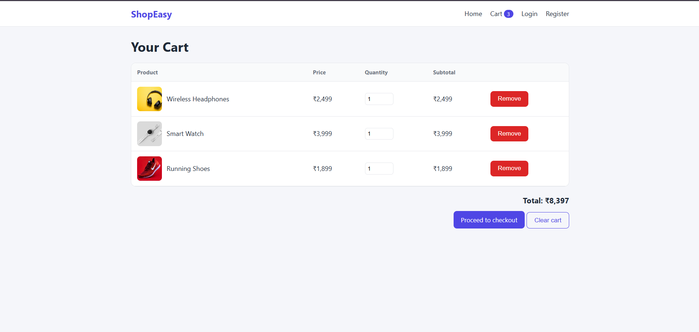
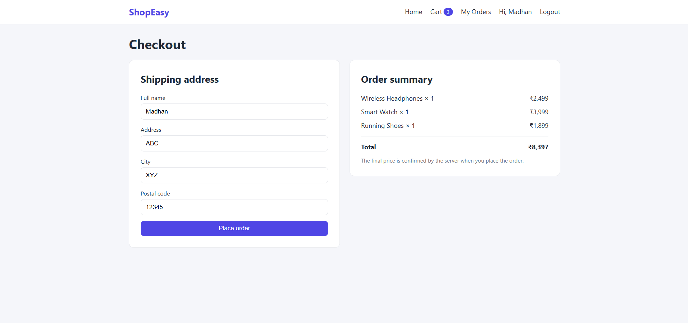
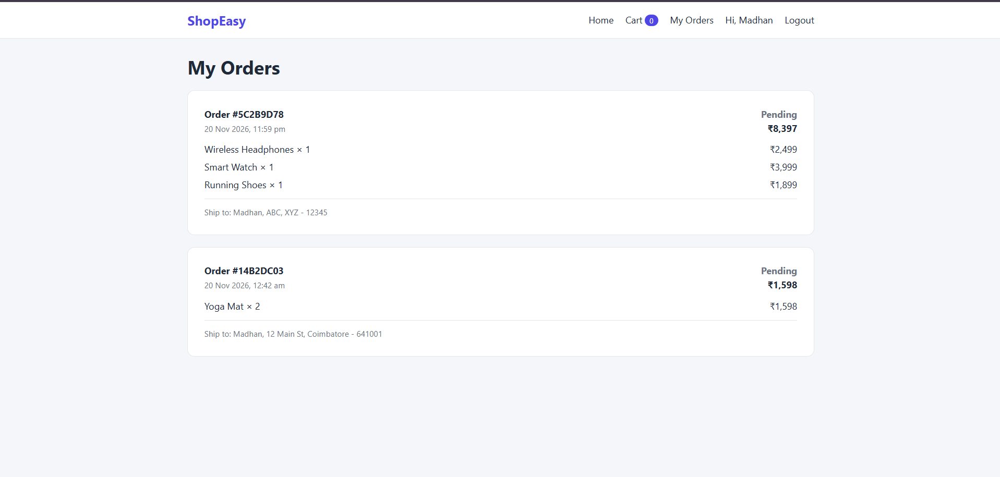

# CodeAlpha_EcommerceStore

A full stack e-commerce web application built for the **CodeAlpha Full Stack Development Internship (Task 1)**.

Users can browse products, view details, add items to a cart, register and log in, place orders, and view their order history.

## Features

- Product listing with search and category filter
- Product details page with stock information
- Shopping cart (quantity changes, remove items, clear cart)
- User registration and login with JWT authentication
- Checkout with a shipping address and order processing
- Order history for each logged-in user
- Admin-only API routes for adding, editing and deleting products
- Server-side price calculation and stock checks (prices are never trusted from the browser)

## Tech Stack

- **Frontend:** HTML, CSS, JavaScript
- **Backend:** Node.js, Express.js
- **Database:** MongoDB (Mongoose)
- **Authentication:** JSON Web Tokens (JWT), bcrypt password hashing

## Project Structure

```
CodeAlpha_EcommerceStore/
├── config/         # database connection
├── controllers/    # request logic (auth, products, orders)
├── middleware/     # JWT auth and admin check
├── models/         # Mongoose schemas (User, Product, Order)
├── routes/         # API routes
├── seed/           # sample data script
├── public/         # frontend (HTML, CSS, JS)
└── server.js       # app entry point
```

## Getting Started

### Prerequisites

- Node.js
- A MongoDB database (local or a free MongoDB Atlas cluster)

### Installation

1. Clone the repository
   ```bash
   git clone https://github.com/madhan77cse/CodeAlpha_EcommerceStore.git
   cd CodeAlpha_EcommerceStore
   ```

2. Install dependencies
   ```bash
   npm install
   ```

3. Create a `.env` file in the project root (see `.env.example`)
   ```
   PORT=5000
   JWT_SECRET=your_secret_here
   MONGO_URI=your_mongodb_connection_string
   ```

4. Add sample products and an admin account
   ```bash
   npm run seed
   ```

5. Start the app
   ```bash
   npm run dev
   ```

6. Open **http://localhost:5000** in your browser

### Demo admin account

After running the seed script: `admin@store.com` / `admin123`
(for local testing only)

## API Endpoints

| Method | Endpoint | Access | Description |
|---|---|---|---|
| POST | `/api/auth/register` | Public | Create an account |
| POST | `/api/auth/login` | Public | Log in and receive a token |
| GET | `/api/auth/me` | Logged in | Get the current user |
| GET | `/api/products` | Public | List products (`?search=` and `?category=`) |
| GET | `/api/products/:id` | Public | Get one product |
| POST | `/api/products` | Admin | Add a product |
| PUT | `/api/products/:id` | Admin | Update a product |
| DELETE | `/api/products/:id` | Admin | Delete a product |
| POST | `/api/orders` | Logged in | Place an order |
| GET | `/api/orders/mine` | Logged in | List your orders |

## Screenshots

### Home page


### Product details


### Cart


### Checkout


### My orders


## Author

Madhan S, built as part of the CodeAlpha internship.